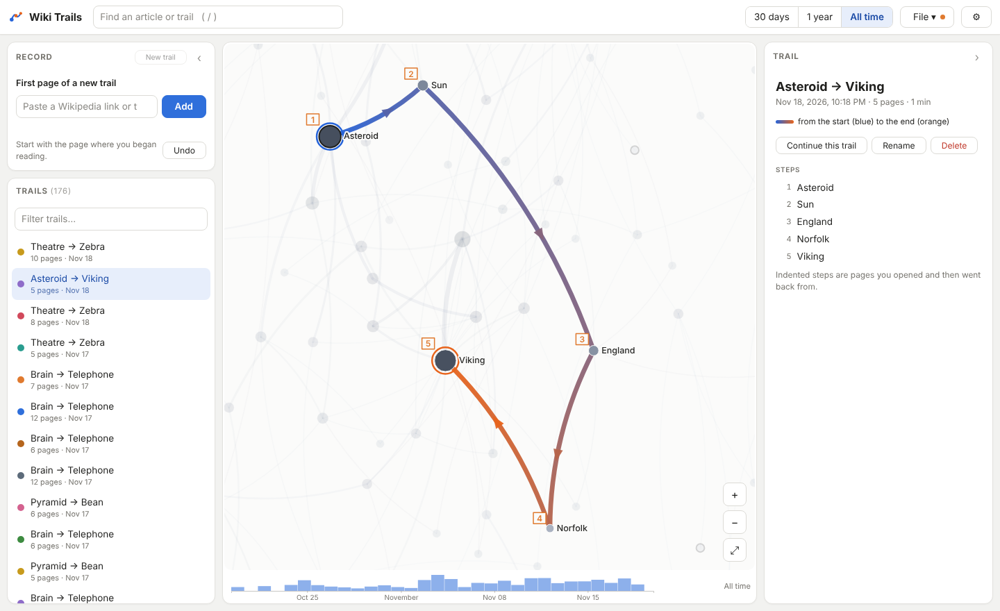
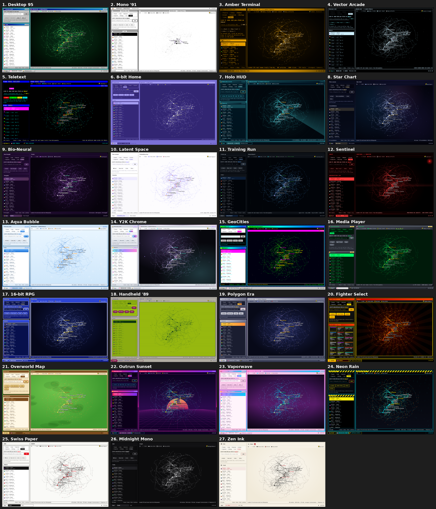

# Wiki Trails

Map how you wander through Wikipedia. You record each trail by hand (first page, then the link you clicked, then the next…), and Wiki Trails draws all of them as one brain-like graph on a green phosphor CRT inside a Windows 95 desktop. Connections you use often grow thicker and glow, the way well-used pathways between neurons strengthen.








## Features

- **Guided trail builder.** Paste the first page's URL or type its title, then answer “Link 2”, “Link 3”, …
- **Branching.** Click any earlier step, or that article in the graph, to go back and continue from there, just like the browser's back button.
- **Revisits and loops are fine.** Every article is a single node, so landing on an article you already know links into it. Repeating the same click again strengthens that connection.
- **Weighted connections.** The thickness and glow of a line come from the total number of clicks between those two articles, across all trails.
- **“How did I get here?”** Hover any article to see every route that led to it, coloured by trail, with animated direction.
- **Full journeys.** Hover a trail's start article, or a trail in the sidebar, to see that journey from start to every end, with step numbers.
- **Pin and zoom.** Click an article or a trail to keep its highlight and zoom in to it; press <kbd>Esc</kbd> or click the background to zoom back out.
- **Calm at any size.** Built to still feel like day one after years of use. At full zoom-out only the ~380 strongest connections are drawn, and zooming in reveals more in the area you are looking at. Labels never overlap, and the most important ones win. Sizes are relative to your busiest article, and connections you haven't used for a while fade (toggle *Fade old*). Use the **Density** slider to see more or less.
- **Fills the window.** The map stretches to the window's shape. Each side window can be minimized to the taskbar (click it there to bring it back), and **Maximize** (<kbd>F</kbd>) hides both. The map is stable: article positions are saved, so it doesn't reshuffle from day to day. New articles settle next to the ones they came from, and *Re-layout* starts fresh.
- **Time lens.** The timeline under the graph shows your clicks over time. Pick *30 days*, *1 year* or *All*, or drag a range. The map keeps its layout; it just shows that period.
- **Focus mode.** Double-click an article to see only its neighbourhood; <kbd>Esc</kbd> goes back.
- **Click a connection** to highlight every trail that used it and see how often you clicked it in each direction.
- **History files.** **Save** (<kbd>Ctrl</kbd>+<kbd>S</kbd>) and **Open** (<kbd>Ctrl</kbd>+<kbd>O</kbd>), or drop a file onto the window. In Chrome/Edge, Save remembers the file, so <kbd>Ctrl</kbd>+<kbd>S</kbd> just updates it; other browsers download a copy. Opening asks whether to **Merge** into your history or **Replace** it. The file includes the map layout, and the app reminds you when it's been a while since your last save.
- **27 skins in 7 families.** Press <kbd>S</kbd>, or use the Skins button, to open the gallery. Hover a card to try a skin live, click to keep it, use <kbd>←</kbd>/<kbd>→</kbd> to flip through them, or press **Slideshow** to tour them all.
  - *Retro computing:* Desktop 95 · Mono '91 · Amber Terminal · Vector Arcade · Teletext · 8-bit Home
  - *Futuristic:* Holo HUD (radar sweep) · Star Chart (constellations) · Bio-Neural (travelling signals)
  - *AI:* Latent Space · Training Run (epochs, loss sparkline) · Sentinel (its red eye follows your cursor)
  - *Millennium / Y2K:* Aqua Bubble · Y2K Chrome (millennium countdown) · GeoCities (hit counter, marquee) · Media Player (trails are tracks)
  - *90s console games:* 16-bit RPG (quests, XP, level-ups) · Handheld '89 · Polygon Era (memory cards) · Fighter Select (VS splash) · Overworld Map (walking marker)
  - *Synthwave:* Outrun Sunset (animated grid) · Vaporwave (VHS glitches) · Neon Rain
  - *Minimal:* Swiss Paper · Midnight Mono · Zen Ink

  Each skin sets its own window chrome, fonts, node shape, line style, background effect, wording and little toys. Optional sound effects can be turned on in the Start menu.
- **Test data.** Start → *Load test data* loads real human Wikispeedia trails: *30 days* (1,000 clicks) or *2 years* (20,000 clicks, 3,145 articles), to see how it feels after long use.
- **Your data stays local.** Trails are stored in your browser (IndexedDB, so years of history fit), and you can save them to a file. Undo with <kbd>Ctrl</kbd>/<kbd>⌘</kbd>+<kbd>Z</kbd>; step back with <kbd>Alt</kbd>+<kbd>←</kbd>.

## Run it locally

Just open `index.html` in your browser by double-clicking it. Nothing to install.

### Developing

The code lives in `src/` as ES modules and is bundled into `js/app.js` (the bundle is committed, so the site needs no build on GitHub). After editing `src/`:

```bash
npm install        # once, installs esbuild
npm run build      # or: npm run watch
npm run serve      # optional: http://localhost:8000
```

## Host on GitHub Pages

1. Push this repo to GitHub.
2. **Settings → Pages → Build and deployment → Source: Deploy from a branch**, then pick `main` and `/ (root)`.
3. The site appears at `https://<user>.github.io/<repo>/`.

### Publishing your own graph

Visitors who have no local data see the file `data/trails.json`, if it exists (on the hosted site; browsers don't allow reading it when the page is opened from disk). To publish your graph:

1. Click **Export JSON** in the app.
2. Save the file as `data/trails.json` and commit it.

Your own browser keeps using its local copy. If you want to start from the published file instead, use **Import JSON**.

## Test data: real human trails

`data/wikispeedia-1000.json` (and the same data as `data/wikispeedia-1000.js`, which the app loads so it also works from disk) holds 176 real human navigation paths (1,000 clicks, 401 articles, 36 back-steps) from the [Wikispeedia](https://snap.stanford.edu/data/wikispeedia.html) dataset. Players went from one article to a target article by clicking links on the page. Most of the sample is from the four most-played games (Brain → Telephone, Asteroid → Viking, Theatre → Zebra, Pyramid → Bean), so shared routes build up thick connections. The rest are random one-off games. In Wikispeedia a `<` means the player went back, which maps directly to Wiki Trails' branching.

To regenerate the file or change its size:

```bash
python3 scripts/build_test_data.py path/to/paths_finished.tsv data/wikispeedia-1000.json 1000
```

Sources: Robert West and Jure Leskovec, *Human Wayfinding in Information Networks*, WWW 2012; Robert West, Joelle Pineau and Doina Precup, *Wikispeedia: An Online Game for Inferring Semantic Distances between Concepts*, IJCAI 2009. The article content comes from Wikipedia (CC BY-SA).

## Data format

```json
{
  "version": 2,
  "lang": "en",
  "trails": [
    {
      "id": "k3j2…", "name": "", "created": "2026-11-18T09:00:00.000Z",
      "visits": [
        { "id": "a", "article": "Brain",   "parent": null, "t": 1763456400000 },
        { "id": "b", "article": "Neuron",  "parent": "a" },
        { "id": "c", "article": "Synapse", "parent": "b" },
        { "id": "d", "article": "Axon",    "parent": "b" }
      ]
    }
  ]
}
```

`t` is when you clicked (ms since 1970). A saved file may also contain `layout` (article → [x, y]) so the map looks the same after opening it. Each trail is a tree of visits. A visit's `parent` is the page you clicked from, so going back and branching just means attaching a new visit to an earlier one. Going back is not a click and adds no connection. Articles and weighted connections are derived from the visits: a connection's weight is the number of clicks between its two articles in either direction, counted over all trails.

## Project layout

```
index.html        page shell
js/app.js         bundled app (built from src/ with esbuild)
css/style.css     base layout; every visual reads a CSS variable (defaults = Desktop 95)
css/skins.css     chrome presets (bevel, flat, neon, terminal, console, gloss, 1-bit) + 27 skins
src/skins.js      skin list: graph palette, node shape, effects, wording, toys
src/effects.js    animated background layer (stars, rain, radar, grid, bubbles, …)
src/model.js      data model and derived graph (articles, weighted links, routes)
src/graph.js      canvas renderer: draw budgets, label placement, layout (d3-force), highlights
src/main.js       UI: builder, trail list, article card, import/export
src/storage.js    IndexedDB, history files (save/open/merge), data/trails.json
src/example.js    small example dataset
data/             wikispeedia-1000.json test data; put your published trails.json here
scripts/          build_test_data.py (Wikispeedia → Wiki Trails JSON)
vendor/d3.min.js  d3 v7.9.0 (ISC licence, see vendor/d3.LICENSE)
```

## Licence

MIT, see [LICENSE](LICENSE). d3 is © Mike Bostock, ISC licence. Fonts: Pixelify Sans and VT323 (SIL OFL) via Google Fonts. The look is inspired by Windows 95, and no Microsoft assets are used.

## Adding a skin

1. Add an entry to `SKINS` in `src/skins.js`: an `id`, a name, a family, a chrome preset, colours, a node shape and an optional effect.
2. Add a `[data-skin="your-id"] { … }` block of CSS variables to `css/skins.css`, plus any `html[data-skin="your-id"] …` extras.

The gallery picks it up automatically.

Skin names describe a style; they are not affiliated with any product.
