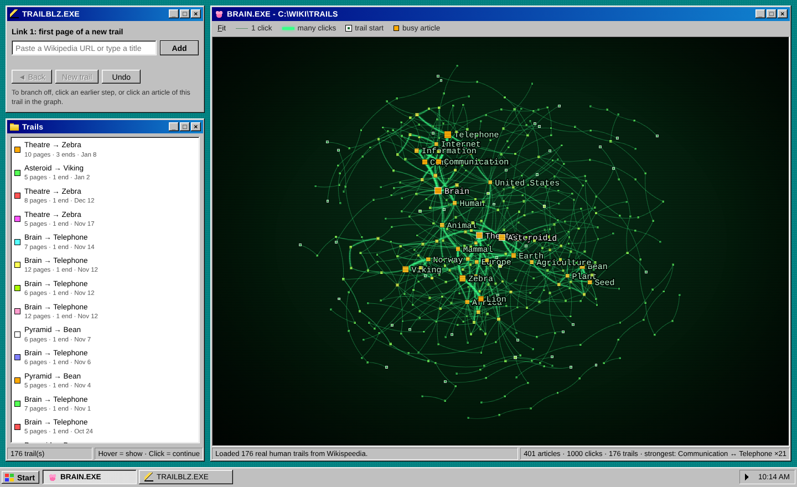

# Wiki Trails 95

Map how you wander through Wikipedia. You record each trail by hand (first page, then the link you clicked, then the next…), and Wiki Trails draws all of them as one brain-like graph on a green phosphor CRT inside a Windows 95 desktop. Connections you use often grow thicker and glow, the way well-used pathways between neurons strengthen.




## Features

- **Guided trail builder.** Paste the first page's URL or type its title, then answer “Link 2”, “Link 3”, …
- **Branching.** Click any earlier step, or that article in the graph, to go back and continue from there, just like the browser's back button.
- **Revisits and loops are fine.** Every article is a single node, so landing on an article you already know links into it. Repeating the same click again strengthens that connection.
- **Weighted connections.** The thickness and glow of a line come from the total number of clicks between those two articles, across all trails.
- **“How did I get here?”** Hover any article to see every route that led to it, coloured by trail, with animated direction.
- **Full journeys.** Hover a trail's start article, or a trail in the sidebar, to see that journey from start to every end, with step numbers.
- **Pin and zoom.** Click an article or a trail to keep its highlight and zoom in to it; press <kbd>Esc</kbd> or click the background to zoom back out.
- **Test data.** Start → *Load test data* loads 1,000 real clicks from 176 human Wikispeedia trails (see below).
- **Your data stays local.** Trails are stored in your browser (`localStorage`), with JSON export and import. Undo with <kbd>Ctrl</kbd>/<kbd>⌘</kbd>+<kbd>Z</kbd>; step back with <kbd>Alt</kbd>+<kbd>←</kbd>.

## Run it locally

It's a static site with no build step. ES modules need a local server (opening `index.html` as a file won't work):

```bash
python3 -m http.server 8000
# open http://localhost:8000
```

## Host on GitHub Pages

1. Push this repo to GitHub.
2. **Settings → Pages → Build and deployment → Source: Deploy from a branch**, then pick `main` and `/ (root)`.
3. The site appears at `https://<user>.github.io/<repo>/`.

### Publishing your own graph

Visitors who have no local data see the file `data/trails.json`, if it exists. To publish your graph:

1. Click **Export JSON** in the app.
2. Save the file as `data/trails.json` and commit it.

Your own browser keeps using its local copy. If you want to start from the published file instead, use **Import JSON**.

## Test data: real human trails

`data/wikispeedia-1000.json` holds 176 real human navigation paths (1,000 clicks, 401 articles, 36 back-steps) from the [Wikispeedia](https://snap.stanford.edu/data/wikispeedia.html) dataset. Players went from one article to a target article by clicking links on the page. Most of the sample is from the four most-played games (Brain → Telephone, Asteroid → Viking, Theatre → Zebra, Pyramid → Bean), so shared routes build up thick connections. The rest are random one-off games. In Wikispeedia a `<` means the player went back, which maps directly to Wiki Trails' branching.

To regenerate the file or change its size:

```bash
python3 scripts/build_test_data.py path/to/paths_finished.tsv data/wikispeedia-1000.json 1000
```

Sources: Robert West and Jure Leskovec, *Human Wayfinding in Information Networks*, WWW 2012; Robert West, Joelle Pineau and Doina Precup, *Wikispeedia: An Online Game for Inferring Semantic Distances between Concepts*, IJCAI 2009. The article content comes from Wikipedia (CC BY-SA).

## Data format

```json
{
  "version": 2,
  "lang": "en",
  "trails": [
    {
      "id": "k3j2…", "name": "", "created": "2026-11-18T09:00:00.000Z",
      "visits": [
        { "id": "a", "article": "Brain",   "parent": null },
        { "id": "b", "article": "Neuron",  "parent": "a" },
        { "id": "c", "article": "Synapse", "parent": "b" },
        { "id": "d", "article": "Axon",    "parent": "b" }
      ]
    }
  ]
}
```

Each trail is a tree of visits. A visit's `parent` is the page you clicked from, so going back and branching just means attaching a new visit to an earlier one. Going back is not a click and adds no connection. Articles and weighted connections are derived from the visits: a connection's weight is the number of clicks between its two articles in either direction, counted over all trails.

## Project layout

```
index.html        page shell
css/style.css     styles
js/model.js       data model and derived graph (articles, weighted links, routes)
js/graph.js       d3 force layout, rendering, highlights
js/main.js        UI: builder, trail list, article card, import/export
js/storage.js     localStorage + data/trails.json + JSON files
js/example.js     small example dataset
data/             wikispeedia-1000.json test data; put your published trails.json here
scripts/          build_test_data.py (Wikispeedia → Wiki Trails JSON)
vendor/d3.min.js  d3 v7.9.0 (ISC licence, see vendor/d3.LICENSE)
```

## Licence

MIT, see [LICENSE](LICENSE). d3 is © Mike Bostock, ISC licence. Fonts: Pixelify Sans and VT323 (SIL OFL) via Google Fonts. The look is inspired by Windows 95, and no Microsoft assets are used.
