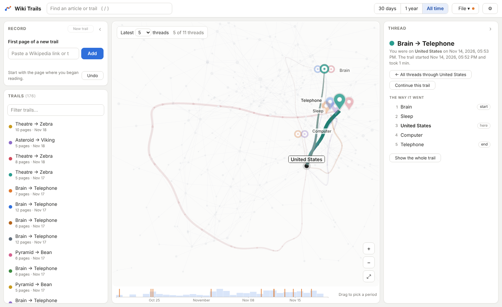
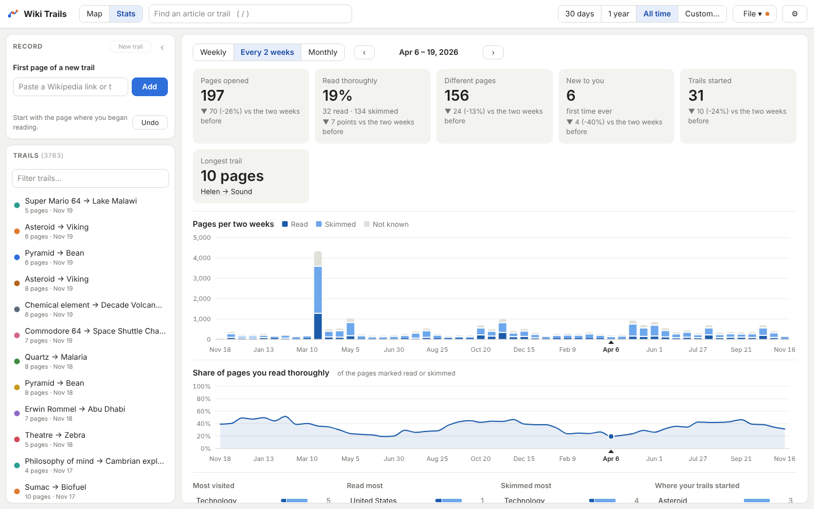
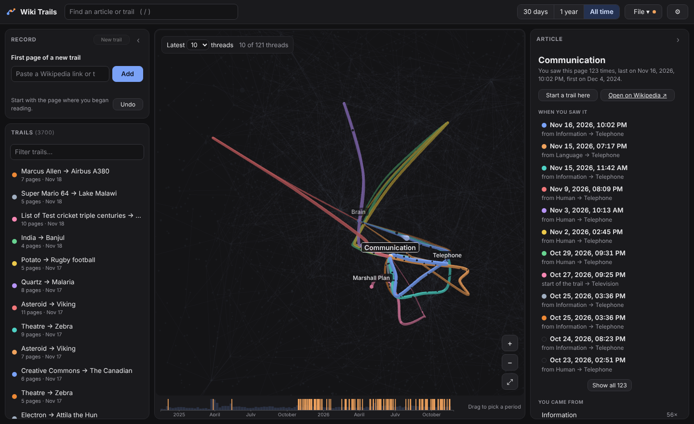
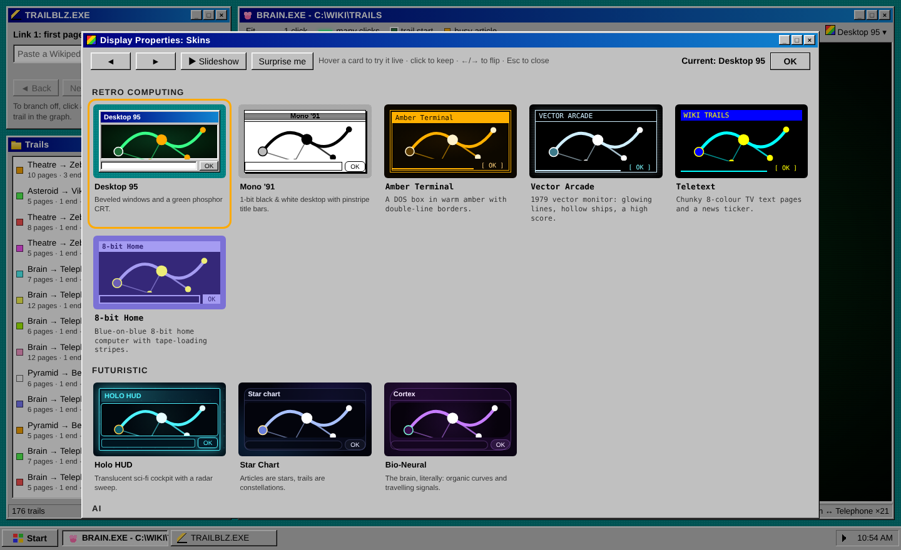
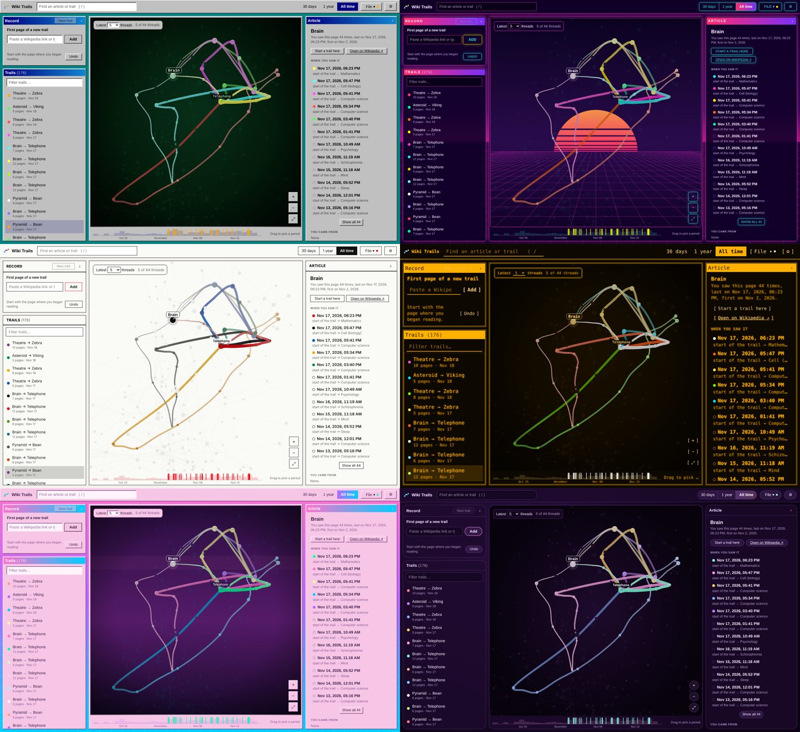
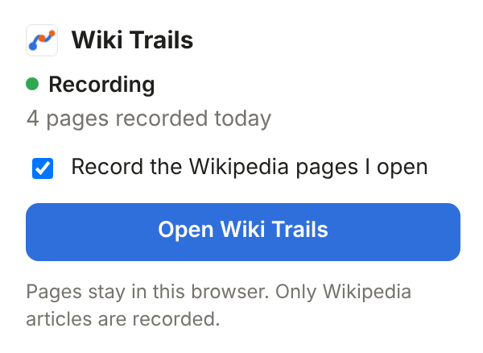

# Wiki Trails

Map how you wander through Wikipedia. Each trail is the page you started on, then each link you clicked. The [browser extension](#the-browser-extension) records them while you read, in Edge, Chrome and Safari; you can also record trails by hand. Wiki Trails draws all your trails as one brain-like network in 3D. Connections you use often are brighter and thicker, the way well-used pathways between neurons strengthen.

Click any article and the trails that went through it light up, and you can read them at a glance:

- **Each trail has its own colour.**
- **A ring marks where it started and a pin where it ended.** Both stay on top and keep their size at any zoom. When several trails start or end on the same page, their rings or pins sit side by side.
- **The way it went:** each trail is thin where it started and bold where it ended, with arrowheads along it pointing from start to end.
- **How you read each page:** on a trail, a page you read thoroughly is a solid bead and one you skimmed an open ring. In the overview, pages you mostly read are strong and pages you mostly skimmed pale.
- **The newest trail is the solid one,** and each older trail is fainter than the one before, so you can tell the order without reading any dates. Only the newest carries the moving light. How strongly they fade is a setting.

The camera turns to the angle where the trails spread out best and fills the window with them. Click a trail anywhere and it's shown in full while the others step back; the side panel explains it. Zoom out and you're back to your whole history.


## How it works

The window has one map and two side panels, and both panels can be collapsed.

- **Map** (middle). Drag to turn it, scroll to zoom. Click an article to see its trails, then click one of the trails to focus it. Click empty space or press <kbd>Esc</kbd> to step back (first from the trail, then to your whole history), or zoom far out. Hover anything to see when you last saw it.
- **Latest N threads** (over the map, while something is selected): show the latest 1, 3, 5, 10, 20 or 50 trails through it.
- **Timeline** (under the map). It shows your clicks over time; pick *30 days*, *1 year* or *All time* in the top bar, choose *Custom…* to enter a start and end date, or drag across the timeline to look at any period. With an article selected, it marks each time you were on that page, and dragging picks the period whose trails are drawn.
- **Record** (left). With the extension, it shows whether pages are being recorded, with a *Pause* button. To record by hand, paste a Wikipedia link or type a title for the first page, then add each page you clicked next. To go back like the browser's back button, click an earlier step and continue from there; your trail then branches. Revisits and loops are fine. Every article is one node in the network, so arriving somewhere you have been before links into it.
- **Skimmed or read.** For the page you're on, click *Skimmed* or *Read*. If you don't, it's guessed from how long it was until you opened the next page: one minute or more counts as read (you can change that in Settings). Each step shows a small mark: a filled dot for read, a ring for skimmed, dotted when it's only a guess. Click a mark to change it.
- **Trails** (left, below). All your trails, newest first, with a filter. Click one to see it on its own, with every page named.
- **Details** (right). Shows what you selected:
  - **An article:** how often you saw it, first and last; where you came from and where you went on to; buttons to start a new trail there or open it on Wikipedia.
  - **A trail you clicked on the map:** where it started and ended, when you were on the page, and every page in order. Click a page to go to it.
  - **A trail from the list:** its steps, with Continue, Rename and Delete.




### Stats

The **Stats** tab next to *Map* shows how much you browsed and how deeply you read: **weekly**, **every 2 weeks** or **monthly**.

- **Tiles for the chosen period**, each compared with the period before: pages opened, how many you read thoroughly, different pages, pages that were new to you, trails started, and the longest trail.
- **Pages per period**, split into read, skimmed and not known, and the **share of pages you read thoroughly** over time. Hover a column for its numbers; click it (or use ‹ ›) to look at that period.
- **Lists for the period:** most visited, read most, skimmed most, and where your trails started. Click a page or the longest trail to open it on the map.
- **A table** of every period, for exact numbers.
- **Time period:** the top bar's choice (30 days, 1 year, custom) limits the stats too.



### Built to last for years

It should still feel like day one after years of use.

- **Calm overview.** The whole history shows every article, but only the strongest ~1,400 connections, and only the busiest articles are named.
- **A handful of trails at a time.** A click shows the latest five trails by default, so even a page you've seen 600 times stays readable.
- **Fading.** Connections you haven't used for a while fade.
- **Stable layout.** Positions are saved, so the network doesn't reshuffle from day to day. New articles settle next to the page you came from.




### Your data

- **Stored locally.** Everything stays in your browser (IndexedDB, so years of history fit).
- **Save to a file.** **File → Save** (<kbd>Ctrl</kbd>+<kbd>S</kbd>) writes a history file. In Chrome and Edge it remembers the file, so later saves update it; other browsers download a copy. A dot on the File button reminds you when it's been a while.
- **Open a file.** **File → Open** (<kbd>Ctrl</kbd>+<kbd>O</kbd>), or drop a file onto the window. You choose whether to add it to your history or replace your history with it.
- **Undo.** <kbd>Ctrl</kbd>/<kbd>⌘</kbd>+<kbd>Z</kbd> undoes the last change.

### Settings

The ⚙ button opens Settings:

- **Light or dark.** Follows your system by default.
- **Look.** Plain is the default, and 27 optional looks are available. Hover a card to try one, click to keep it.
- **Map:** how many connections to show, fade old connections, how much older threads fade, turn the map slowly when you're not using it, and re-arrange it from scratch.
- **Reading:** colour pages by how you read them or by how often you were there; guess from the time between pages whether you read or skimmed (on or off); and how long a page has to stay open to count as read.
- **Other:** the Wikipedia language for links, and optional sounds.



<details>
<summary>All 28 looks</summary>



- *Plain*
- *Retro computing:* Desktop 95 · Mono '91 · Amber Terminal · Vector Arcade · Teletext · 8-bit Home
- *Futuristic:* Holo HUD · Star Chart · Bio-Neural
- *AI:* Latent Space · Training Run · Sentinel
- *Millennium / Y2K:* Aqua Bubble · Y2K Chrome · GeoCities · Media Player
- *90s console games:* 16-bit RPG · Handheld '89 · Polygon Era · Fighter Select · Overworld Map
- *Synthwave:* Outrun Sunset · Vaporwave · Neon Rain
- *Minimal:* Swiss Paper · Midnight Mono · Zen Ink

Look names describe a style; they are not affiliated with any product.
</details>

### Keyboard

| Key | Action |
| --- | --- |
| <kbd>/</kbd> | Find an article or trail |
| <kbd>Esc</kbd> | Let go of the focused trail, then back to your whole history |
| <kbd>Ctrl</kbd>+<kbd>Z</kbd> | Undo |
| <kbd>Ctrl</kbd>+<kbd>S</kbd> | Save history to a file (<kbd>Shift</kbd> for Save as) |
| <kbd>Ctrl</kbd>+<kbd>O</kbd> | Open a history file |

Drag to turn the map, scroll to zoom.

### Try it with real data

**File → Examples** loads real human trails from the Wikispeedia game: *30 days* (1,000 clicks) or *2 years* (20,000 clicks, 3,117 articles). The 2-year example shows how the map feels after long use. Loading it replaces your history, but you can undo that.

## Run it

Open `index.html` in your browser by double-clicking it. Nothing to install. Or install the browser extension, which records your trails and includes the app.

## The browser extension

The extension records your trails while you read Wikipedia, with nothing to type. It works in Microsoft Edge and Google Chrome, and in Safari on a Mac. Wiki Trails itself comes with it: click the extension's button in the toolbar, then **Open Wiki Trails**. New pages appear in the map as you read, even while the app is open.



### What it records

- **Every Wikipedia article you open**, in any language. Talk pages, search results, edit views and the Main Page are not recorded.
- **A link you click** becomes the next step of the trail you're on, also when you open it in a new tab.
- **Back and forward** add no step. The next link you click branches from the page you went back to, as in the app.
- **A new trail starts** when you arrive from anywhere else: a search engine, a bookmark, an address you typed, Wikipedia's search box or its Main Page.
- **Reloading** a page adds nothing.
- **How long each page was in front of you**, and how far you scrolled. Time only counts while the tab is visible and you have moved the mouse, scrolled or typed in the last two minutes. A page you spent at least a minute on counts as read; you can change that under Settings → *Read after*, and you can still mark any page yourself.

To pause, click the toolbar button and untick *Record the Wikipedia pages I open*, or click *Pause* in the Record panel. While it's paused, the button shows "off".

**Privacy.** The extension only runs on Wikipedia article pages, and the only permission it asks for is storage. It sends nothing anywhere: the pages go into the browser's own storage, and the app keeps your history there too. The app loads its fonts from Google Fonts, like the website does; without a connection it uses your system's fonts.

**Each browser keeps its own history.** Edge, Safari and the website each have a separate one. To bring them together, use **File → Save** in one and **File → Open → Add to my history** in the other. Trails that are already there aren't added twice.

### Install in Edge (or Chrome)

1. Unzip `wiki-trails-extension.zip` to a folder where it can stay, for example `Documents\wiki-trails-extension`. Edge loads the extension from there each time it starts, so don't delete the folder.
2. Go to `edge://extensions` (`chrome://extensions` in Chrome), turn on **Developer mode** and click **Load unpacked**. Choose the unzipped folder, the one with `manifest.json` in it.
3. To keep the button in view, click the Extensions button next to the address bar and choose **Show in toolbar** next to Wiki Trails.

To update, unzip the new version over the old folder and click **Reload** under Wiki Trails in `edge://extensions`. Your history stays: the extension keeps the same identity even if you move it to another folder.

### Install in Safari on a Mac

Safari only takes extensions that come inside a Mac app, so you build that app once with Xcode, which is free from the Mac App Store.

1. Unzip `wiki-trails-extension.zip` and this repository.
2. In Terminal, in the repository folder, run `bash scripts/package_safari.sh ~/Downloads/wiki-trails-extension` (with the path of your unzipped extension folder). It builds a small app called Wiki Trails and opens it.
3. In Safari, open **Settings → Advanced** and tick **Show features for web developers**. Then, under **Settings → Developer**, tick **Allow unsigned extensions**.
4. Under **Settings → Extensions**, tick **Wiki Trails**. Allow it on Wikipedia when Safari asks, choosing *Always Allow on This Website*. Each language's Wikipedia (en, de, …) is a website of its own, so you may need to allow it again for another language.

**After Safari restarts.** An app you build yourself counts as unsigned, and Safari turns *Allow unsigned extensions* off each time it quits. Tick it again under **Settings → Developer** after you open Safari; until you do, the extension is off and records nothing. To avoid that step, the app has to be signed with an Apple Developer ID and notarized, which needs a paid Apple Developer Program membership and Safari 18.4 or later.

**Only trying it out?** Under **Settings → Developer**, **Add Temporary Extension…** loads the unzipped folder without Xcode. Safari removes it after 24 hours or when it quits, and what it recorded can go with it, so save your history to a file (**File → Save**) before then.

**iPhone and iPad** need the extension inside an iOS app, which you can only install with a paid Apple Developer Program membership. The script builds for the Mac only.

### Host on GitHub Pages

1. Push this repo to GitHub.
2. Go to **Settings → Pages → Build and deployment → Source: Deploy from a branch**, then pick `main` and `/ (root)`.
3. The site appears at `https://<user>.github.io/<repo>/`.

To publish your own map, save your history with **File → Save as**, put the file at `data/trails.json`, and commit it. Visitors with no history of their own see that file. This only works on the hosted site: browsers don't allow reading it when the page is opened from disk. Your own browser keeps using its local history.

### Developing

The code lives in `src/` as ES modules and is bundled into `js/app.js`. The bundle is committed, so GitHub Pages needs no build step. After editing `src/`:

```bash
npm install        # once: esbuild, three.js and 3d-force-graph
npm run build      # or: npm run watch
npm run serve      # optional: http://localhost:8000
npm run build:extension   # the extension, with the app inside: dist/extension and dist/wiki-trails-extension.zip
```

```
index.html            page: top bar, three panels, Settings and Open dialogs
js/app.js             bundled app (built from src/, includes three.js and 3d-force-graph)
css/style.css         layout and components; every colour is a CSS variable
css/skins.css         plain light/dark, window styles, and the 27 optional looks
src/main.js           wires the map, panels and keyboard together
src/app.js            app state, selection, events, and the highlight for a selection
src/model.js          data model: trails → articles and weighted connections
src/storage.js        IndexedDB, history files (save/open/merge), data/trails.json
src/appearance.js     light/dark and looks
src/skins.js          the list of looks: map palette, dot shape, background effect
src/ui.js             small helpers (dates, toasts, the steps list)
src/panels/           record, trails, details, search, timeline, menus, stats
src/views/map3d.js    the 3D network (3d-force-graph), threads drawn with three.js, labels, camera
src/views/effects.js  animated backgrounds for some looks
src/bridge.js         in the extension: adds the pages the recorder noted to your history
src/example.js        tiny example
js/early.js           applies your theme before the page draws (a file, since extensions forbid inline scripts)
data/                 Wikispeedia examples; your published trails.json goes here
extension/            the browser extension: manifest, page.js (runs on Wikipedia), recorder.js (decides
                      where each page belongs), the toolbar popup and icons
scripts/              build_test_data.py (Wikispeedia → Wiki Trails), build_extension.mjs, package_safari.sh
vendor/d3.min.js      d3 v7.9.0
```

#### Adding a look

1. Add an entry to `SKINS` in `src/skins.js`: an `id`, a name, a family, a window style, map colours, a dot shape and an optional background effect.
2. Add a `[data-skin="your-id"] { … }` block of CSS variables to `css/skins.css`.

The Settings gallery picks it up automatically.

## Data format

```json
{
  "version": 2,
  "lang": "en",
  "trails": [
    {
      "id": "k3j2…", "name": "", "created": "2026-11-18T09:00:00.000Z",
      "visits": [
        { "id": "a", "article": "Brain",   "parent": null, "t": 1763456400000, "read": "read" },
        { "id": "b", "article": "Neuron",  "parent": "a",  "t": 1763456460000 },
        { "id": "c", "article": "Synapse", "parent": "b",  "t": 1763456520000 },
        { "id": "d", "article": "Axon",    "parent": "b",  "t": 1763456600000 }
      ]
    }
  ],
  "layout": { "Brain": [12.5, -40.1, 8.3] }
}
```

- **A trail is a tree of visits.** A visit's `parent` is the page you clicked from. Going back and branching means attaching a new visit to an earlier one; in the example, you read Synapse, went back to Neuron and clicked Axon.
- **Going back is not a click** and adds no connection.
- **`t`** is when you opened the page, in milliseconds since 1970.
- **`read`** is optional: `"read"` or `"skim"` when you said how you read the page. Without it, the app goes by `secs`, or else guesses from the time until the next page.
- **`secs`** and **`scroll`** are optional and come from the extension: the seconds the page was in front of you, and how far down you scrolled (0 to 1). **`src`** is `"auto"` for a page the extension recorded.
- **`layout`** is optional and keeps the network looking the same after you open the file: each article's position in 3D. Files from the older flat map have two numbers per article; those positions are ignored and the network is arranged afresh.
- **Derived data.** Articles and connections are computed from the visits. A connection's weight is the number of clicks between its two articles, in either direction, over all trails.

## Test data: Wikispeedia

The examples are real human navigation paths from the [Wikispeedia](https://snap.stanford.edu/data/wikispeedia.html) dataset. Players went from one article to a target article by clicking links on the page, and a `<` in their path means they went back, which maps directly to branching here. The timestamps are spread over 30 days or 2 years so the time lens has something to show. Players raced, so their own timings are all a few seconds per page; the time on each page is simulated instead (about a third read for minutes, the rest skimmed), so reading depth and the stats have something to show.

- `data/wikispeedia-1000.json` (also `.js`, so it loads from disk): 176 paths, 1,000 clicks, 401 articles. Most come from the four most-played games (Brain → Telephone, Asteroid → Viking, Theatre → Zebra, Pyramid → Bean), so shared routes build up thick connections.
- `data/wikispeedia-2years.js`: 3,763 paths, 20,008 clicks, 3,117 articles.

To regenerate or resize them:

```bash
python3 scripts/build_test_data.py path/to/paths_finished.tsv data/wikispeedia-1000.json 1000 30      # 30 days
python3 scripts/build_test_data.py path/to/paths_finished.tsv /tmp/wikispeedia-2years.json 20000 730  # 2 years, then copy the .js into data/
```

Sources:

- Robert West and Jure Leskovec, *Human Wayfinding in Information Networks*, WWW 2012.
- Robert West, Joelle Pineau and Doina Precup, *Wikispeedia: An Online Game for Inferring Semantic Distances between Concepts*, IJCAI 2009.
- Article content: Wikipedia (CC BY-SA).

## Licence

MIT, see [LICENSE](LICENSE).

- d3 is © Mike Bostock, ISC licence (see `vendor/d3.LICENSE`).
- The bundle in `js/app.js` includes [three.js](https://threejs.org) and [3d-force-graph](https://github.com/vasturiano/3d-force-graph) with their dependencies, all under MIT, ISC or BSD licences; their notices are in `js/THIRD-PARTY-LICENSES.txt`.
- Fonts are loaded from Google Fonts under the SIL Open Font Licence: Inter and the fonts of the optional looks.
